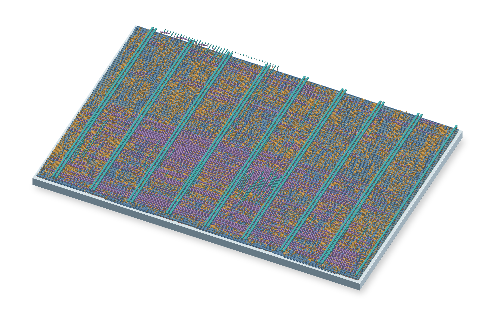

# Tang Nano 20K flyover audio filter

## Tiny Tapeout chip

The ASIC version targets Tiny Tapeout SKY130 (SKY26e) in a **2×2** tile.
It uses the same 48 kHz Pmod I2S2 codec and attenuates a detected falling
tone and its second and fourth harmonics. Its streaming filter uses
no external memory and starts attenuating after it has confirmed a fall.
See the [chip datasheet source](docs/info.md) for wiring and bench tests.



Run `make -C test` with Icarus Verilog and Python 3 installed. On Windows,
put `iverilog` and `vvp` on PATH and run `python test/run.py`. The tests
exercise I²S framing, signed PCM, bypass, reset, falling and rising sweeps,
and steady tones. The synthetic mix uses the same three harmonics and
1,750 Hz control tone as the FPGA simulation.

For fabrication, use the revision with a passing `gds` workflow (including
precheck and gate-level simulation) and a passing `docs` workflow. The GDS
job publishes the `tt_submission` artifact. Add this repository and select
that revision in the [Tiny Tapeout submission portal](https://app.tinytapeout.com/projects/create).

The Tiny Tapeout design, tests, datasheet source, metadata and workflows
are licensed under [Apache-2.0](LICENSE). The build configuration and
workflows are adapted from the [Tiny Tapeout SKY Verilog template](https://github.com/TinyTapeout/ttsky-verilog-template).

## About

Aircraft noise in a soundtrack can reveal where it was recorded. Flyover Detector is a Tang Nano 20K FPGA prototype that detects and reduces the falling tones left by propeller aircraft and helicopters. It processes mono audio at 48 kHz and uses a 1.024-second buffer so it can edit the start of a detected flyover before sending the audio to a recorder or livestream. The Digilent Pmod I2S2 supplies the analog input and output.

**Prototype status.** The GW2AR-18C image passed FPGA timing and simulation checks. Physical board testing and suppression tests on real recordings are pending. Faint, unusually slow, or broadband flyovers can remain in the output, and other sustained pitch changes can trigger the filter.

## Wire the audio module

You need a Tang Nano 20K with headers, a Digilent Pmod I2S2 (410-379), short jumper wires, and a USB-C data cable. Use a line-level source or a microphone with a preamp. The Pmod line output goes to a recorder or computer audio interface with a line input.

Disconnect USB power before wiring. Set the Pmod's ADC jumper to **Slave** so the Tang drives both converters' clocks. The numbers on the Tang side refer to the **FPGA pin labels** in Sipeed's pin diagram. Keep the RGB LCD connector free. [Tang pin diagram](https://wiki.sipeed.com/hardware/en/tang/tang-nano-20k/nano-20k.html#pin-diagram), [Pmod schematic](https://digilent.com/reference/_media/reference/pmod/pmodi2s2/pmodi2s2_sch.pdf)

| Tang label | Signal | Pmod I2S2 J1 pins |
| --- | --- | --- |
| 25 | Master clock, 12.288 MHz | 1 and 7 |
| 26 | Bit clock, 3.072 MHz | 3 and 9 |
| 27 | Left/right clock, 48 kHz | 2 and 8 |
| 28 | Audio data from the Pmod ADC | 10 |
| 29 | Audio data to the Pmod DAC | 4 |
| GND | Ground | 5 and 11 |
| 3V3 | 3.3 V power | 6 and 12 |

Feed the microphone signal to the **left** channel of the Pmod input. Both output channels carry the filtered left-channel signal.

## Set the board clock

1. Connect the Tang Nano 20K over USB-C. Open its USB serial port at **115200 baud, 8N1, no flow control**. Press **Ctrl+X**, then **Ctrl+C**, then **Enter** to reach the BL616 console. Note the current O0 setting if you use the board for another project.
2. Set MS5351 clock output O0 to **49,152 kHz**. The `K` form uses the clock console's integer kilohertz input. Check that O0 is enabled and reports 49.152 MHz or 49,152,000 Hz before saving.

   ```text
   pll_clk O0=49152K
   pll_clk
   pll_clk -s
   ```

3. Close the serial terminal before using the programmer. [Sipeed clock-console instructions](https://wiki.sipeed.com/hardware/en/tang/tang-nano-20k/example/unbox.html#pll_clk)

## Load the firmware

Download [flyover-tang-nano-20k.fs](bitstream/flyover-tang-nano-20k.fs?raw=1) into the folder where you run the commands. Use [openFPGALoader](https://trabucayre.github.io/openFPGALoader/guide/install.html), available in the [OSS CAD Suite](https://github.com/YosysHQ/oss-cad-suite-build#installation). Activate the suite for your operating system first.

SHA-256 for the checked-in image is `bffc1bd299587fce3550dbf4fb83e2299f4fe69fbcfe4de256d8e89aa5c9fefd`.

```text
openFPGALoader -b tangnano20k --detect
openFPGALoader -b tangnano20k flyover-tang-nano-20k.fs
```

This loads the image into FPGA SRAM for a temporary test. After checking that the board passes audio, save the image to external flash so it starts on power-up. This replaces the FPGA image currently in the board's flash.

```text
openFPGALoader -b tangnano20k -f flyover-tang-nano-20k.fs
```

With Gowin Programmer, select **SRAM Mode** for the temporary test or **External Flash Mode** with **Generic Flash** for persistent storage. Both use the same `.fs` file. If the programmer cannot see the board, use a USB data cable directly into the computer and follow the vendor's debugger instructions. [Sipeed programmer walkthrough](https://wiki.sipeed.com/hardware/en/tang/tang-nano-20k/example/led.html), [openFPGALoader troubleshooting](https://trabucayre.github.io/openFPGALoader/guide/troubleshooting.html#cannot-flash-tang-nano-20k-issue-251)

## Check sound and sync

1. Play a steady tone or speak into the preamp at modest gain. **LED0** lights once the delay fills and audio starts. Expect about **1.024 seconds** of delay plus the audio converters' delay. For video, delay the picture by the measured audio delay in your streaming software or align it afterward.
2. Play a recording with a clear propeller flyover. **LED1** lights while the output is being edited. Listen for a drop in the sweeping tone. LED1 reports detected tracks, so compare the input and output recordings when checking an unfamiliar sound.
3. **LED2** signals a missed processing deadline or output buffer fault. The FPGA mutes the output and holds the fault until reloaded or power-cycled. If all LEDs stay off and the clock setting is correct, check MCLK and the audio clocks in the wiring table.

## Build and simulate

Install Node.js and activate the OSS CAD Suite dated **2026-11-10** or a compatible version with support for the GW2A-18C device. From this repository run the build and simulation commands separately.

```text
node build.mjs
node build.mjs test
```

The build writes `build/flyover-tang-nano-20k.fs` and the synthesis and timing logs. It uses LUT-based arithmetic to avoid a reported Gowin carry-chain issue on this device. The simulations cover 24-bit I²S, SDRAM initialization and refresh, FFT scaling, backdating the masks, the complete audio path, and a missed-deadline mute. The end-to-end simulation takes longer than the unit tests. [Gowin carry-chain report](https://github.com/YosysHQ/apicula/issues/514)

The routed design met the 49.152 MHz internal clock target and the packed image passed its frame CRC checks. The end-to-end simulation measured 59.8 dB of reduction on a synthetic sweep mixed with a steady 1,750 Hz tone, over 9,216 output samples after startup. The longest observed hop used 456,452 of the available 1,048,576 clock cycles. Board timing at the codec and SDRAM pins and performance on real recordings still need bench measurements.

### How the FPGA filters audio

It transforms 4,096-sample Hann windows every 1,024 samples. A peak detector measures nearby spectral energy and estimates peak centers between bins. The tracker keeps up to 32 ridges and looks for a persistent downward glide, using harmonically related ridges as corroboration for smaller shifts. Once confirmed, a track is marked back through the 43-hop lookahead buffer. The renderer replaces narrow bands with randomized-phase background-level energy, then performs an inverse transform and overlap-add. Audio starts with a short window ramp after the fixed 49,152-sample delay.

The fixed-point detector uses a logarithmic approximation and sideband averages. It is a hardware implementation of the design, with thresholds and track selection that differ from the floating-point exploration model. The underlying cleanup approach is related to the [AircraftWitness live cleaner](https://arxiv.org/html/2611.08791v1#A11).
